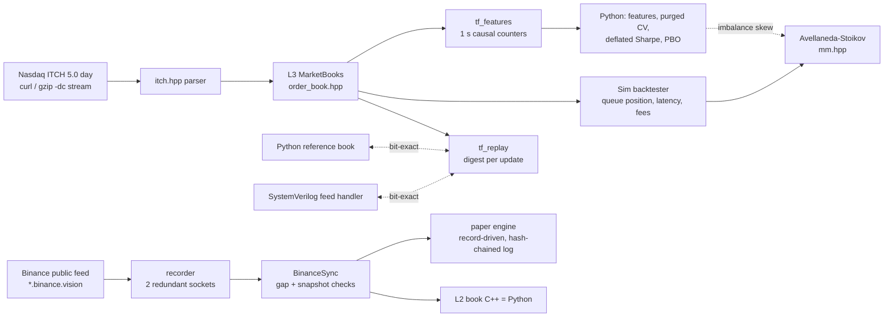

# Tickforge

A limit-order-book research stack, tested on real data:

- a C++20 engine that rebuilds every Nasdaq order book from TotalView-ITCH 5.0,
- a backtester with exact queue-position fills,
- microstructure alpha research with purged walk-forward validation and deflated Sharpe ratios,
- Avellaneda-Stoikov market making,
- live paper trading on the public Binance feed,
- a SystemVerilog feed handler that matches the C++ engine bit for bit.

**Backtesting and paper trading only.** There is no order-submission client for any real venue,
and no exchange keys anywhere (CLAUDE.md rule 4).

## Results in one screen

| What | Result | Evidence |
|---|---|---|
| Full real Nasdaq day (2019-01-30) | 368,366,634 messages, 0 unknown refs, 0 overfills, 0 bad messages, every order gone at the close; **4.7M msgs/s** real, 12M msgs/s synthetic | [m1-replay](docs/results/m1-replay.md) |
| C++ book vs Python reference | bit-exact digest after every update on 2M synthetic messages + 14 random streams | [m1-replay](docs/results/m1-replay.md) |
| Backtester | exact L3 queue position, latency, fees; bit-reproducible; no-look-ahead test | [m2-backtester](docs/results/m2-backtester.md) |
| Crypto L2 path | fixed-point L2 book, C++ = Python digest; every Binance REST snapshot checked against the replayed book: 0 mismatches over 48k compared levels | [m3-l2](docs/results/m3-l2.md) |
| Alpha (7 real Nasdaq days, 15 names) | order book predicts 10 s returns, **OOS IC 0.13**, stable on all 5 test days, but **all 38 trials lose after spread + fees** (deflated Sharpe 0) | [m4-alpha](docs/results/m4-alpha.md), [graveyard](docs/results/graveyard.md) |
| Market making (5 held-out days) | A-S earns 1.7 c/share spread, loses 2.6 c/share to adverse selection: **net loss**; the M4 imbalance skew helps slightly, not significantly | [m5-mm](docs/results/m5-mm.md) |
| Live paper trading (BTCUSDT) | 1.2 h live, 1,345 simulated fills; replaying the recorded feed reproduces the live decision log **byte for byte**; hash-chained log | [m6-paper](docs/results/m6-paper.md) |
| FPGA feed handler | bit-exact vs C++ engine in Verilator; 1 byte/cycle; 4-cycle median latency. Open-source ECP5 synthesis: **22 MHz** on a reduced config, default config does not fit; critical path and fixes identified | [m7-rtl](docs/results/m7-rtl.md), [m8-synth](docs/results/m8-synth.md) |

The honest headline: **the engine, data path and verification are solid; the strategies do not make
money**, and the reports show exactly why (spread and adverse selection), with every failed signal
kept in the graveyard.

## Architecture



## Quick start

```bash
pip install -r requirements-dev.txt
cmake -S . -B build -G Ninja && cmake --build build
ctest --test-dir build --output-on-failure    # C++ unit + golden fixture tests
pytest -q                                      # C++ vs Python, backtester, alpha hygiene, L2 sync, paper engine, RTL vs C++
```

Real-data runs (each results page has its exact commands):

```bash
python data/fetch.py itch-sample --date 01302019                     # 4.8 GB, checksum pinned
gzip -dc data/raw/itch/01302019.NASDAQ_ITCH50.gz | ./build/engine/tf_replay /dev/stdin
make report-alpha                                                    # after tf_features (see m4-alpha)
python -m tickforge.mm_study data/cache/itch_sub                     # after tf_filter
PYTHONPATH=python python -m tickforge.paper run --out data/raw/paper/run --hours 4
```

## Limitations

- Seven free Nasdaq sample days and one crypto pair: a small sample.
- The backtester assumes our orders do not change the real queue (no impact), which is optimistic.
- Not done: the 24-hour gap-free recording and the 2-week paper run. Both need a host that stays up,
  and the development cloud container restarted every 1 to 2 hours. A DeepLOB model, a PPO market
  maker and board bring-up were also not attempted.

## Layout

```
engine/include/tickforge/  itch · order_book · flat_map · replay · digest · sim (backtester) · mm (market maker) · l2_book
engine/tools               tf_replay · tf_backtest · tf_features · tf_filter · tf_mm · tf_l2replay
bindings/                  pybind11 module _tickforge
python/tickforge/          itch codec, reference book, synth, l2 + recorder, binance_dump, features, research, alpha, mm_study, paper
rtl/, verif/, synth/       SystemVerilog feed handler, cocotb bench (Verilator), open-source synthesis script
fixtures/                  committed synthetic fixtures + expected results
data/                      download scripts + checksums (data itself is never committed)
docs/                      ADRs 0001-0011, roadmap, data sources, results
```

Conventions are in [CLAUDE.md](CLAUDE.md).
